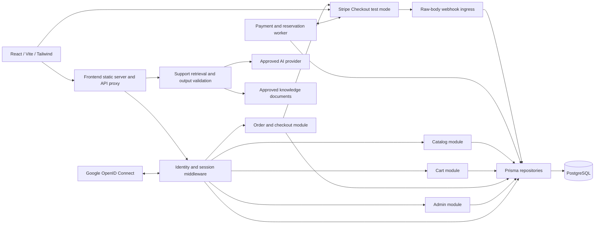
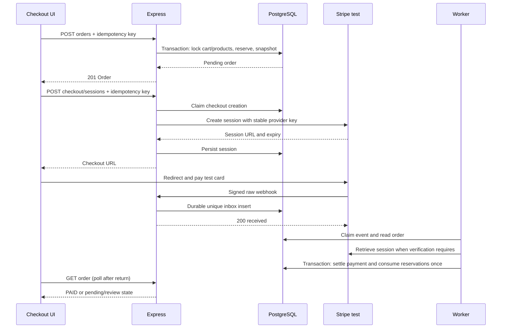
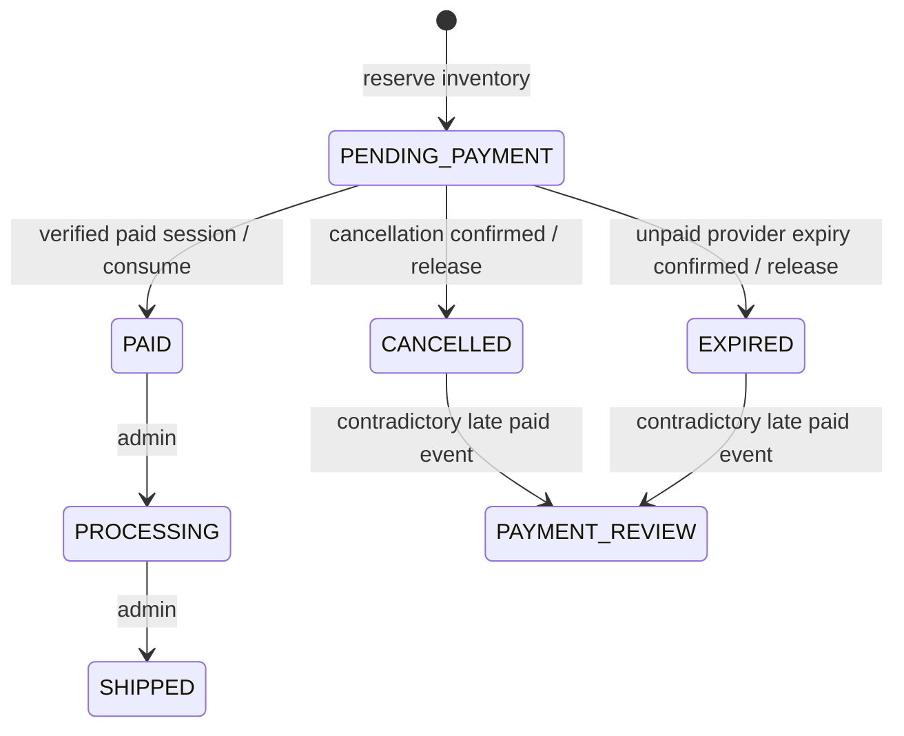

# Component and interaction diagrams

Task ARCH-001. Proposed components; see [system architecture](system-architecture.md) for security and transaction rules.

Support bypasses session requirements but has Origin validation, rate limits, body limits and privacy processing. Admin calls share identity middleware and add live role checks. Webhook ingress bypasses cookie/CSRF middleware and uses signature authentication. All database mutation rules belong in services, not route handlers or React components.

Duplicate events are no-ops. PAYMENT_REVIEW has no automated outgoing transition in MVP. Cancellation intent is orthogonal to status until provider confirmation. External outages hold inventory and require retry/alerting rather than guessing the payment result.
