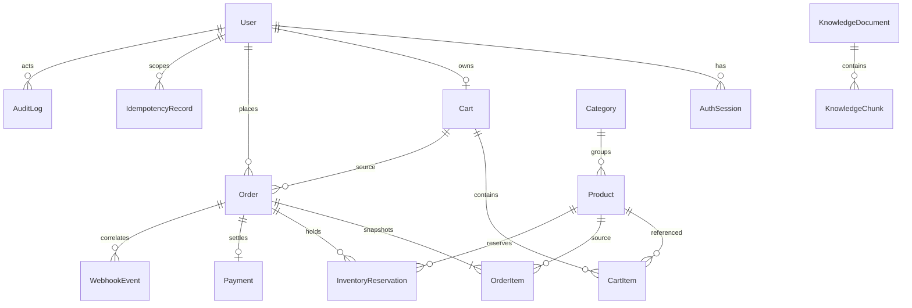

# Entity relationship design

Task ARCH-001. Proposed logical model, not an existing Prisma schema. [Data dictionary](data-dictionary.md) defines every field; [API DTOs](../api/api-contract.md) deliberately differ from persistence entities. Use Prisma PascalCase model names and camelCase fields; avoid raw SQL identifiers that depend on implicit naming conventions.

SEC-001 adds independent SecurityAuditOutbox with non-FK audit references, encrypted JSON storage for address/retry snapshots and immutable Order.checkoutRequestedExpiresAt. See dictionary/security documents for exact deltas. Privacy erasure requires a reviewed lifecycle migration before production; historical RESTRICT references alone do not implement deletion.

OAuthAttempt is a short-lived independent entity. WebhookEvent.orderId is nullable until correlation and has an optional FK: events can arrive before the Checkout session has been persisted. IdempotencyRecord resources are generic response snapshots, not foreign-key references. AuditLog resource IDs are textual audit references that survive archival. No chat/message entity is defined because transcripts are not retained.

## Core relational constraints

User.googleSubject unique; User.email normalized lowercase unique (collisions require explicit account-link review). Cart.userId unique. CartItem(cartId,productId) unique. Category.slug and Product.sku unique. InventoryReservation(orderId,productId) unique; one line per product per order. Payment.orderId, Payment.stripeSessionId, and non-null Payment.stripePaymentIntentId unique. Order.stripeSessionId unique when present; WebhookEvent.stripeEventId unique. IdempotencyRecord(userId,method,route,key) unique. KnowledgeDocument(documentId,version) and KnowledgeChunk(documentVersionId,section,ordinal) unique.

Add a partial unique index on Order(cartId,cartVersion) WHERE status='PENDING_PAYMENT' to enforce one pending order per cart version. Nonnegative stock/totals and stockReserved<=stockOnHand require database CHECK constraints. Quantity bounds 1..99, positive versions and valid enum values require constraints. Aggregate totals and reservation sums require service transactions; a simple row CHECK cannot assert cross-row aggregates. Validate drift with a reconciliation report, never silently rewrite balances.

Foreign keys use RESTRICT for historical entities; archive products/users instead of hard deletion until the reviewed privacy lifecycle migration is implemented. CartItem may cascade when a cart is explicitly removed under that retention process; routine logout never deletes carts. OrderItem.productId remains a reference but commercial fields are snapshots. Address is an immutable API-validated snapshot stored as an authenticated-encryption JSON envelope, with no mutable address-book join. All timestamps use PostgreSQL timestamptz, money integer cents, and UUID primary keys generated by the backend. No floating-point monetary columns.

## Important query indexes

Product(categoryId,active,price,id), Product(active,createdAt,id), Order(userId,createdAt,id), Order(status,reservationExpiresAt), InventoryReservation(status,expiresAt), WebhookEvent(status,nextAttemptAt), AuthSession(userId,expiresAt), OAuthAttempt(expiresAt), IdempotencyRecord(expiresAt), AuditLog(resourceType,resourceId,createdAt), KnowledgeChunk(documentVersionId). Start with parameterized ILIKE search; add an indexed normalized search implementation only after measurement, preserving literal search semantics.

## Lifecycle integrity

Order creation locks cart and product rows, validates version and constraints, writes order/items/reservations and increments reserved stock in one transaction. Payment success moves ACTIVE reservations to CONSUMED and decrements both stock counters atomically. Cancellation/expiry moves ACTIVE to RELEASED and decrements only reserved stock. Every writer follows the same order/product lock order. Do not decrement stock from the webhook ingress itself. Worker claims use an atomic conditional update/lease or SELECT FOR UPDATE SKIP LOCKED; an expired lease may be reclaimed, so business effects must remain idempotent.

Admin stock edits lock the same Product rows and cannot reduce physical stock below reservations. Product archival stops new orders but does not invalidate already committed order snapshots. A database failure at any intermediate step must roll back all local changes; cross-system Stripe calls use durable order state and reconciliation rather than distributed transactions.
