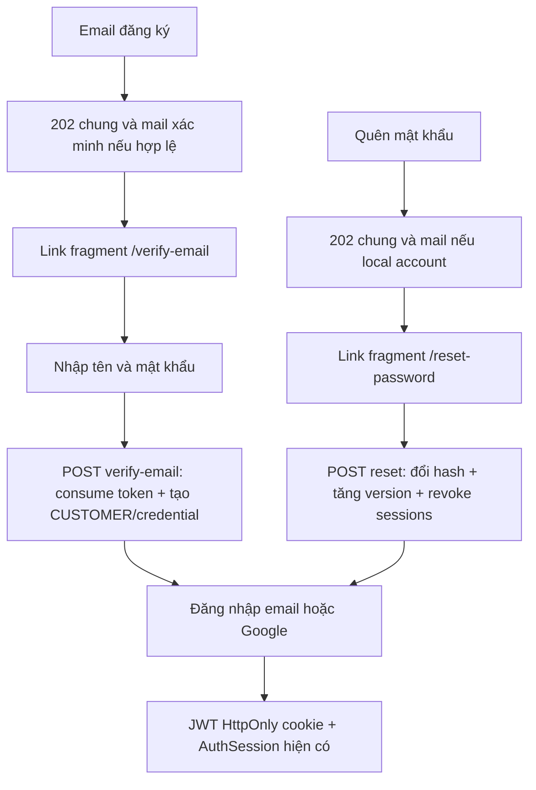

# AUTH-002 — Kế hoạch đăng nhập, đăng ký, quên mật khẩu

Ngày:2026-11-23. Kế hoạch do Architect viết trong docs/. User sau đó giao vai trò Orchestrator, chỉ định agy CLI để triển khai backend/frontend theo prompt; ràng buộc không commit, không xóa dữ liệu/đổi production secrets/chạy destructive migration vẫn bắt buộc. [Hợp đồng API mở rộng](../api/email-password-auth-contract.md) và [prompt giao việc](agy-auth-task.md) là đầu vào bàn giao. Chỉ báo đã gọi sau khi thực thi thật và chỉ báo hoàn tất sau kiểm tra kết quả/tests.

## Hiện trạng đã kiểm tra

- Backend có Express/CommonJS, Prisma6/PostgreSQL, Zod, Google OIDC, JWT cookie, session/CSRF/logout; các file `backend/src/modules/auth/auth.routes.js`, `auth.service.js`, `auth.repository.js`, `backend/src/middleware/auth.js`, `backend/src/config/crypto.js` đã tồn tại.
- User trong `backend/prisma/schema.prisma` bắt buộc googleSubject và chưa có passwordHash/emailVerifiedAt/local credential/token reset. Không được nhét mật khẩu vào googleSubject hoặc dùng fake Google subject cho tài khoản local.
- Frontend React/TypeScript/Vite có `/login`, GoogleLoginButton, AuthContext, authApi và ProtectedRoute; chưa có form local registration/login/recovery. App.tsx quản lý route, session lấy qua GET auth/session; tận dụng flow này thay vì tạo auth context/token storage mới.
- Backend có Jest unit/integration nhưng integration fixture hiện có `inMemoryPrisma.js`; không đủ chứng minh transaction/constraint/race. Frontend có Playwright dùng API mock. Backend package chưa có Argon2/mailer dependency. Có package scripts test:unit, test:integration; frontend typecheck/build/test:e2e. Chưa cài/chạy suite trong công việc tài liệu này.

## Phạm vi và quyết định

Giữ Google login. Thêm tài khoản email/mật khẩu qua xác minh email hai bước; đăng nhập local; quên/reset mật khẩu; logout hiện có; gửi mail transactional. Không mở rộng refresh token, social linking, thay đổi email, SMS, security questions hoặc tự cấp admin. Mật khẩu local không thay thế MFA admin và không đóng các production security gates còn mở.

Luồng đăng ký: nhập email -> nhận link30phút -> nhập tên/mật khẩu mới trên trang xác minh -> tài khoản CUSTOMER được tạo -> chủ động đăng nhập. Không nhận/lưu password trước chứng minh email. Luồng quên: nhập email -> thông báo chung -> link15phút -> mật khẩu mới -> thu hồi mọi phiên -> đăng nhập lại. Token dùng một lần; link scanner GET không tiêu thụ. Google-only tiếp tục dùng Google, không được nhận mật khẩu local qua chức năng quên.

## Model đề xuất chính xác và migration

Đây là trường/bảng MỚI đề xuất, chưa có trong schema; implementer phải viết migration mới, không sửa migration init đã tồn tại hoặc dữ liệu agent khác.

| Model | Delta/schema mới |
|---|---|
| User | googleSubject String? @unique, null cho local; thêm emailVerifiedAt DateTime? timestamptz; giữ email normalized unique, role CUSTOMER mặc định; quan hệ credential?, registration/token không phụ thuộc User chưa tồn tại |
| PasswordCredential | userId UUID PK/FK User RESTRICT; passwordHash text PHC Argon2id; version int>=1 default1; passwordChangedAt timestamptz default now; createdAt/updatedAt timestamptz; một credential/user |
| AuthActionToken | id UUID PK; purpose enum VERIFY_EMAIL/RESET_PASSWORD; tokenHash char64 unique; email text normalized; userId UUID? FK User RESTRICT, null chỉ VERIFY_EMAIL; credentialVersion int? (required RESET, null VERIFY); expiresAt timestamptz; consumedAt timestamptz?; createdAt default now; index(purpose,email,expiresAt), index(userId,purpose,expiresAt). Không lưu raw token/password/địa chỉ |
| AuthMailOutbox | id UUID PK; dedupeKey text unique<=200 (token ID+template hoặc credential version+notification); template enum VERIFY_EMAIL/RESET_PASSWORD/PASSWORD_CHANGED; encryptedPayload JSONB? envelope theo data-protection, chứa recipient và token chỉ khi cần gửi, null sau purge; status enum PENDING/SENDING/SENT/FAILED; attempts int>=0 default0; nextAttemptAt timestamptz default now; claimUntil timestamptz?; sentAt timestamptz?; lastErrorCode text?<=100; createdAt default now; index(status,nextAttemptAt) |

VERIFY token không gắn user và không tạo chỗ giữ email trong User. RESET token phải gắn một user có local credential, email khớp và version credential lúc phát hành. SHA-256 phù hợp token random256bits, không phù hợp password. Mail raw token tồn tại tạm thời chỉ trong payload envelope vì worker cần gửi; được xóa payload sau gửi hoặc hết hạn, tối đa24h, tuyệt đối không log. Worker mail dùng identity riêng chỉ decrypt mail purpose, không mượn Stripe worker full quyền hoặc đọc địa chỉ đơn hàng. SecurityAuditOutbox bổ sung eventType cho AUTH_REGISTER_REQUESTED, EMAIL_VERIFIED, PASSWORD_RESET_REQUESTED, PASSWORD_RESET_SUCCEEDED, AUTH_MAIL_FAILED; không email/raw token trong metadata.

Lifecycle kỹ thuật đề xuất: purge AuthActionToken trong1h sau consumed/expiry; outbox payload null ngay khi xác nhận gửi hoặc khi token hết hạn, không retry mail link đã hết hạn; metadata outbox giữ7ngày rồi purge. AuthMailOutbox không lưu raw lỗi SMTP có recipient/link. Khóa advisory theo HMAC(email) hoặc hàng limiter tương đương để serialize số token live khi email chưa có User; constraint đơn thuần trên nullable userId không đủ. SMTP timeout10s, tối đa5 attempts với backoff trong token lifetime; hết budget ghi FAILED/alert, không đổi202 cũ thành báo gửi thành công giả. Mail delivery có thể trùng khi crash sau send/trước sentAt; cùng token/dedupe key và provider idempotency khi hỗ trợ hạn chế tác động, không tuyên bố exactly-once email.

Migration không đổi IDs/User.cart/orders/sessions. Không backfill emailVerifiedAt mù quáng cho seed/fake Google users: đánh dấu existing Google users khi có evidence xác minh đáng tin hoặc sau lần Google login mới hợp lệ. Callback Google mới set emailVerifiedAt khi verified claim đã kiểm tra. Session của Google cũ không bị phá do trường nullable; local login chỉ khi có credential và verifiedAt. Backfill chuẩn hóa email trước constraint với báo cáo collision; không tự merge. App service phải bảo đảm mỗi user có ít nhất Google subject hoặc local credential; không tạo user local nếu credential write thất bại.

Hai registration cùng email: unique index + transaction chỉ tạo một User; loser400 AUTH_TOKEN_INVALID chung, không tạo thêm credential/session. Google/local cạnh tranh cùng email không auto-link, xác thực đúng đường phải quay lại login phù hợp. Không fake dữ liệu DB để làm test xanh.

## Chính sách password/session/email

Argon2id bằng thư viện maintained; minimum m=19456KiB,t=2,p=1, salt random riêng và PHC format tự mô tả; benchmark target<500ms/hash trên máy triển khai, tăng cost khi đủ capacity, không giảm dưới minimum nếu máy yếu. Rehash sau login khi cấu hình thay đổi, có kiểm tra version tránh overwrite reset. Đếm code points, NFC15..128; không trim/cắt/đổi hoa thường, không rotation định kỳ vô cớ, chặn common/breached list versioned. Có show/hide, paste và password manager; autocomplete đúng.

Tái sử dụng ES25615phút, cookie production __Host-session, AuthSession authoritative và role DB; local login không nhận role/userId/MFA flag từ body. Token password-reset không phải app JWT. Reset thu hồi tất cả phiên, không tự đăng nhập, gửi email thông báo không có mật khẩu. Chỉ owner mới cấu hình SMTP/provider/verified sender, SPF/DKIM/DMARC và frontend origin; mail provider approval/processing retention là production gate. Dùng mail adapter inject được, fake sink cho tests, không gửi email thật khi chạy suite.

Nguồn để implementer đối chiếu: [OWASP reset an toàn](https://cheatsheetseries.owasp.org/cheatsheets/Forgot_Password_Cheat_Sheet.html), [OWASP password storage](https://cheatsheetseries.owasp.org/cheatsheets/Password_Storage_Cheat_Sheet.html), [NIST password guidance](https://pages.nist.gov/800-63-4/sp800-63b.html). Các thông số ở đây là lựa chọn thiết kế; không khẳng định đạt chứng nhận NIST/ASVS. Tuân theo [security gates](../security/security-requirements.md).

## Gói triển khai và trách nhiệm

| Task | Owner / thứ tự | Phạm vi code dự kiến | Done khi |
|---|---|---|---|
| AUTH-BE-01 | Backend, đầu tiên | schema + migration mới, AuthActionToken/PasswordCredential/mail outbox repository, grants/purge | Migrate được DB mới và DB có Google fixture, constraint/rollback pass |
| AUTH-BE-02 | Backend, sau01 | PasswordService/Argon2 validator, preauth CSRF, register/verify/login/forgot/reset, reuse session factory | API khớp hợp đồng; không phá Google/session/logout; atomic race tests pass |
| AUTH-BE-03 | Backend, song song02 sau model | mail adapter/outbox worker, fixed links, encryption, retry/idempotency, env example dummy/README | Fake mail end-to-end; worker không lộ secrets và không spam retry |
| AUTH-FE-01 | Frontend, dùng contract sẵn | mở rộng LoginPage; RegisterPage, VerifyEmailPage, ForgotPasswordPage, ResetPasswordPage; authApi/AuthContext/types/router | Loading/error/success, accessible labels, confirmPassword local, không storage/leak |
| AUTH-FE-02 | Frontend, sauFE01 | Playwright mock và real-backend journeys; frontend privacy/cache cleanup | Email token fragment không query/network log; Google button/return flow vẫn hoạt động |
| AUTH-QA-01 | Backend+Frontend, sau API/FE | real PostgreSQL + fake mail integration; hai trình duyệt; critical security regression | Báo cáo command/result/skip, không dùng chỉ mock để khẳng định concurrency |
| AUTH-OPS-01 | Integrator/Owner | cấu hình secrets/provider, origin, mail identity, lifecycle/grants/alerts; root CI/Compose nếu cần | Không commit secret; recipient/sender đã xác minh; user duyệt merge/deploy |

Backend sở hữu backend/, Frontend sở hữu frontend/, Architect docs/. Một “agy” làm cả hai phải được user phân công hai thư mục rõ ràng hoặc điều phối đúng hai agent; không ghi đè work đang chạy. Không thay đổi root config/Git history từ prompt này. Dependency phù hợp nằm package.json/lockfile trong thư mục owner; dùng manager theo lockfile hiện trạng, không tạo lockfile manager khác tùy tiện.

## UI và lỗi

- `/login`: email/password + Google, link đăng ký/quên; thành công reload auth/session rồi về account hoặc đường nội bộ allowlisted từ ProtectedRoute; không nhận redirect URL tuyệt đối/`//`/encoded bypass.
- `/register`: email, submit/202 và resend có cooldown; không hiển thị email tồn tại/không tồn tại. Không lưu pending token vào state URL query.
- `/verify-email`: lấy token fragment vào memory và xóa ngay, nhập tên/password/confirm, submit POST rõ ràng. Link hết hạn/đã dùng có hướng dẫn đăng ký lại chung; không GET auto-verify.
- `/forgot-password`: email, cùng success mọi loại tài khoản, nhắc nút Google chung không theo kết quả lookup.
- `/reset-password`: password/confirm/show-hide, token trong memory; success chuyển login, clear private AuthContext/cart cache; không tự đăng nhập. Trang không redirect-away chỉ vì còn session cũ.

Tất cả input có label/error summary/focus và aria-live hợp lý, mobile360px/desktop, disable submit khi pending; không đưa secret vào toast/console/error reporter. Không khóa paste hoặc password manager. Link scanner không thay đổi tài khoản. 429 tôn trọng Retry-After, không auto-retry POST auth ngoài quy tắc token/CSRF. Không thay đổi bảy màn hình kinh doanh: đây là các view hỗ trợ xác thực mới.

## Kiểm thử và nghiệm thu

Backend unit: password Unicode/NFC/whitespace/length/blocklist/Argon2 salt/rehash; token random/hash/purpose/expiry; fixed URL; error mapping và email redaction. Supertest: schema/Origin/preauth, consistent register/forgot202, wrong-email/wrong-password/Google-only401, role injection, token reuse, logout/revocation, CSRF rotation, shared quota/outbox failures.

Real PostgreSQL integration: verify cạnh tranh chỉ tạo một user, token consumed đúng một lần, register vs Google email collision, reset cùng token/hai token cùng credentialVersion, reset vs old-password login, rollback khi audit/mail write lỗi, migration giữ orders/cart/Google identity. InMemoryPrisma có thể dùng bổ sung nhưng không thay thế transaction tests. Mail delivery failure không consume verification token hoặc báo giả đã xác minh; payload được purge đúng hạn.

Playwright: đăng ký nhận email test->verify->login/logout; forgot/reset->old password401/new password success; session ở trình duyệt2 bị revoke; invalid/expired link; Google regression; XSS in displayName rendered text; không JWT/token/password trong localStorage/sessionStorage/URL query/log/HAR. Giữ test token synthetic trong fixture bảo mật; không bật real SMTP/Google credentials trong CI mocks.

Lệnh có thật trong package hiện tại: backend `npm run test:unit`, `npm run test:integration`; frontend `npm run typecheck`, `npm run build`, `npm run test:e2e`. Agent phải kiểm tra lockfile/tool trước khi install; integration mới cần DB test tách biệt và mail fake. Báo rõ suite chưa chạy vì thiếu DB/provider/dependency, không nói “hoàn tất” chỉ vì build pass. Run security regression liên quan SEC-01..07/10/12..14; password auth không nới MFA/admin gates.

Nghiệm thu: cả ba luồng hoạt động qua browser+backend+mail test; verify/reset token một lần; no enumeration ở response và timing review; mọi session cũ invalid sau reset; dữ liệu Google/cart/order giữ nguyên; không secret/log leak; migration và named tests pass. Không merge/deploy/commit tự ý. Production vẫn chờ owner privacy/mail/MFA/security sign-off.

## Handoff và trạng thái

Ban đầu chưa nhận diện được task “agy”; user đã cung cấp đường dẫn CLI và lệnh PowerShell. Orchestrator kiểm tra tài liệu, chụp danh sách/hash file hiện trạng, gọi CLI thật, đợi kết quả và tự kiểm tra test. agy được giao backend/frontend cho phạm vi AUTH-002; giữ nguyên code agent khác. Ghi receipt/kết quả vào tài liệu orchestration, không coi lời hứa hoặc chỉ exit0 là bằng chứng hoàn thành.
