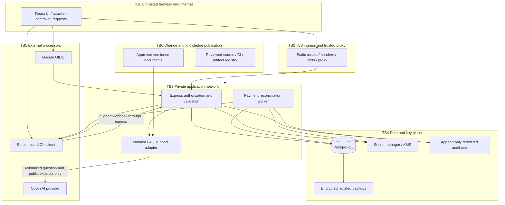

# Threat model

Task SEC-001. Design baseline dated 2026-11-23. Applies to the proposed seven-screen E-Commerce system and its infrastructure. Implementation and mitigation evidence are NOT yet verified: backend/ and frontend/ were absent at inspection. Read [critical acceptance criteria](security-requirements.md) first when planning implementation. Security reduces risk; this model does not establish immunity from compromise.

## Scope, assets and actors

Assets: Google subject/email/name; JWT and CSRF tokens; OAuth state/nonce/PKCE material; carts; order/address/phone snapshots; Stripe session/payment IDs; physical/reserved inventory; catalog prices; approval-controlled knowledge; audit events; backups; signing/encryption/provider keys; source code, dependency lockfiles and CI credentials. Card numbers and CVV are prohibited application data, not database assets.

Actors: anonymous visitor, authenticated customer, admin, Google, Stripe, optional AI provider, API/worker service identities, migration identity, integrator and owner. Adversaries include external attackers, malicious customers/admins, compromised browsers/extensions, compromised dependencies/build systems, stolen service credentials and malicious document contributors. Provider failure, operator mistakes and concurrent requests are threat sources even without malicious intent.

| Classification | Examples | Consequence of exposure/modification |
|---|---|---|
| Public | Active catalog, approved published FAQs | Price/content tampering; misleading policy answers |
| Confidential personal | Identity, order history, shipping details, request IP | Privacy harm, impersonation, stalking or fraud |
| Restricted authentication | Session cookie, OAuth verifier, private keys, provider secrets | Account/service compromise and payment manipulation |
| Restricted financial/integrity | Payment references, amounts, reservations, audit trail | Incorrect fulfillment, overselling, fraud, lost evidence |

Encrypted/pseudonymized personal information still requires access controls and privacy handling; it is not necessarily anonymous. See [European Commission explanation](https://commission.europa.eu/law/law-topic/data-protection/data-protection-explained_en).

## Trust boundaries and data flow

The Support box is a required runtime credential/egress boundary, not merely a function name; [chatbot security](chatbot-security.md) specifies isolation. Edge is trusted only after proxy source verification; inbound forwarded headers are not identity. Internal networks and third-party responses are not inherently trusted. KMS administrative access is separate from DB/backup access.

Attack surfaces: OAuth redirect/callback, all API routes and object IDs, session/CSRF cookies, product text/image URLs, search/query parsers, admin status/stock edits, Checkout session creation, raw webhook ingress, worker leases, document ingestion/retrieval, model output rendering, dependency install/build, container runtime, monitoring endpoints and restore/deletion tooling. No upload, arbitrary URL fetch, file execution, model tools or general SQL endpoint is in scope.

## STRIDE register

Likelihood and impact use 1=low, 2=medium, 3=high; score=product, 6..9 high, 3..4 medium, 1..2 low. Initial ratings are design estimates. Residual ratings assume controls pass; they are not measured risk conclusions. Owner must review after implementation and significant change.

| Threat | STRIDE / boundary | Abuse case | Initial L/I | Required mitigation and evidence | Expected residual / owner |
|---|---|---|---|---|---|
| T-01 | Spoofing / TB1,TB5 | Forged/replayed Google callback or login CSRF | 3/3 | SEC-01: single-use browser-bound state/nonce/PKCE, verified claims; AUTH-SEC tests | Medium: stolen Google session; Backend |
| T-02 | Spoofing, elevation / TB1,TB3 | Stolen JWT, algorithm confusion, stale admin role | 3/3 | SEC-02/03: host cookie, pinned key/claims, DB revocation/current role, MFA gate; SESSION/RBAC tests | Medium: browser compromise; Backend + Frontend |
| T-03 | Disclosure, elevation / TB1,TB4 | Customer reads/cancels another user's order or swaps nested product IDs | 3/3 | SEC-03: actor-scoped queries and same-transaction authorization; BOLA matrix | Low to medium: logic drift; Backend |
| T-04 | Tampering / TB1,TB3 | Client sets price/role/status; injection or mass assignment | 3/3 | SEC-04/07: closed schemas, parameterized SQL, server snapshots/state machine; parser and forged-body tests | Low: untested parser edge; Backend |
| T-05 | Spoofing, tampering / TB1,TB5 | Forged Stripe event or success redirect marks order paid | 3/3 | SEC-08: raw signature verification, mode/amount/session checks, redirect is UI-only; PAY-SEC | Low to medium: leaked provider key; Backend |
| T-06 | Tampering, denial / TB3,TB4 | Concurrent checkout, reordered events or release race corrupts stock | 3/3 | SEC-09: DB constraints/locks, unique effects, durable inbox and provider reconciliation; RACE-SEC | Medium: remote uncertainty holds stock; Backend |
| T-07 | Repudiation / TB3,TB4 | Admin denies edits or deletes local evidence | 2/3 | SEC-12: atomic audit/outbox plus restricted append-only sink, chain of custody; AUDIT-SEC | Medium: privileged operator collusion; Backend + Integrator |
| T-08 | Disclosure / TB4 | Database/backup theft exposes addresses and session/secret material | 2/3 | SEC-10: encrypted volumes/backups and sensitive fields, separate KMS, scoped DB roles; CRYPTO-SEC | Medium: live app compromise can decrypt; Integrator + Backend |
| T-09 | Tampering, elevation / TB1 | Stored product/chat XSS or CSRF alters accounts/admin data | 3/3 | SEC-05/06: text rendering, enforcing CSP, Origin+token, secure cookies; BROWSER-SEC | Medium: extension/third-party browser compromise; Frontend + Backend |
| T-10 | Disclosure, elevation / TB3,TB5 | Prompt injection extracts private records or invokes refund/payment actions | 3/3 | SEC-11: no private corpus/tools/commerce credentials, isolated support, output checks; LLM-SEC | Medium: misleading public answer; Backend + Frontend |
| T-11 | Tampering / TB6 | Poisoned/draft/retired policy becomes model evidence | 2/3 | SEC-11/14: reviewed manifests, version hashes, approval gate and revocation; KNOWLEDGE-SEC | Medium: approver mistake; Owner + Backend |
| T-12 | Denial / TB1,TB3,TB5 | AI bill spike, session spam, stock hoarding, slow requests | 3/2 | SEC-07/09/11: distributed limits, active-order quotas, timeouts, budget/concurrency caps; ABUSE-SEC | Medium: distributed bots and provider outage; Integrator + Backend |
| T-13 | Elevation, tampering / TB6 | Malicious dependency, build secret theft or compromised image | 2/3 | SEC-14: reviewed pinned dependencies/actions/images, SBOM/provenance, secret/SCA scans; PIPELINE-SEC | Medium: new upstream compromise; Integrator |
| T-14 | Disclosure, spoofing / TB2,TB3 | SSRF/image fetch, forged forwarded headers or permissive CORS | 2/3 | SEC-05/07: trusted proxy hops, no server image fetch, egress allowlists, exact Origin; NETWORK-SEC | Low to medium: infrastructure error; Backend + Integrator |
| T-15 | Disclosure, repudiation / TB4,TB5 | Excess retention, unnoticed breach, deleted data restored | 2/3 | SEC-12/13/15: purge/hold rules, tombstones, incident exercises, restore replay; PRIVACY/DR-SEC | Medium: processor delay/legal holds; Owner + Integrator |
| T-16 | Denial, disclosure / TB3,TB4 | KMS/DB/audit failure causes fail-open authorization or lost payment event | 2/3 | SEC-02/08/10/12: fail closed, durable acknowledgement, backpressure, recovery drills; FAILURE-SEC | Medium: availability loss; Backend + Integrator |

## Assumptions and residual risks

Google, Stripe and the approved AI processor have their own security obligations; contracts and sandbox tests do not eliminate supply-chain or availability risk. TLS protects transport, not compromised endpoints. HttpOnly cookies do not stop XSS from issuing authorized requests. Citation validity does not prove an answer is entailed. Encryption does not stop an authorized compromised API reading plaintext. Resource limits deter abuse without proving users are unique. Required MFA assurance and privacy jurisdiction remain release decisions, not inferred from a Google login or US address form.

Owner reviews residual risks before real-user release, records risk owner/expiry/compensating controls, and reopens this model for new APIs, payment methods, private chatbot access, uploads, processors, infrastructure or data categories. No waiver may permit forged payments, cross-user access, card storage, plaintext secrets or known exploitable critical defects.
